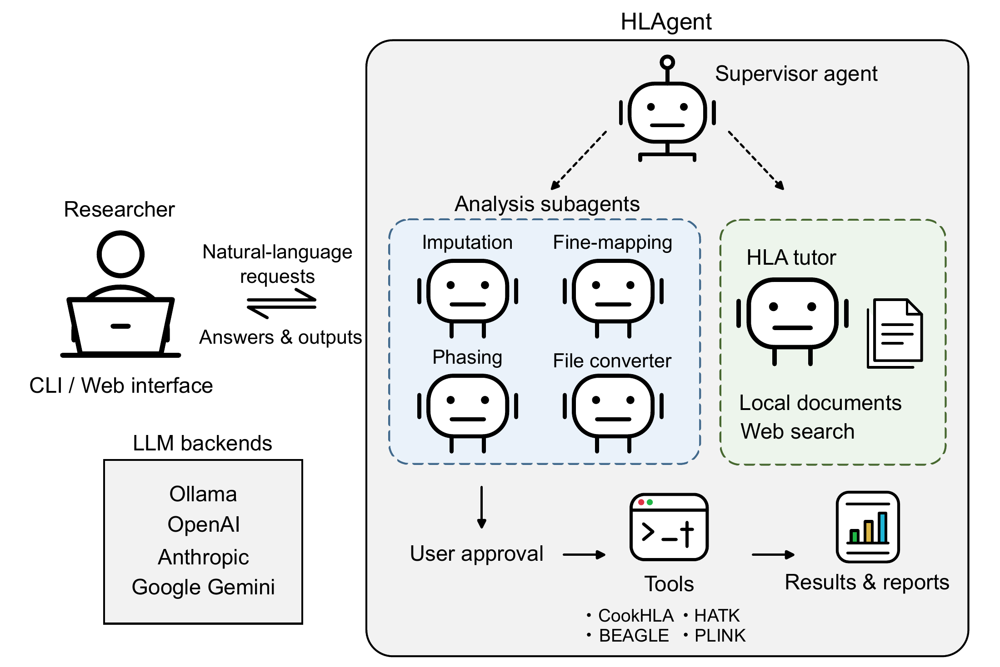

<picture></picture>

**HLAgent is a conversational assistant for HLA research.**

Use the CLI or Web interface for HLA imputation, fine-mapping, genotype phasing,
data preparation and HLA Q&A.

<picture></picture>

## Installation

### Prerequisites

Use a macOS or Linux terminal. Windows users need a Linux environment such as
WSL2.

- **Git and Conda** — Conda is strongly recommended. Install it through
  [Miniconda or Anaconda](https://www.anaconda.com/docs/getting-started/installation).
- **Docker** — Required for HLA analyses. Install
  [Docker Desktop](https://docs.docker.com/get-started/get-docker/)
  for macOS/Windows or [Docker Engine](https://docs.docker.com/engine/install/) for Linux.

\* If you use Docker Desktop, start it before preparing analysis images or running analyses.

### Quick Setup

1. Clone the repository:

   ```bash
   git clone https://github.com/jjoonnL/HLAgent.git
   cd HLAgent
   ```

2. Run setup:

   ```bash
   bash setup.sh
   ```

Running `setup.sh` creates the Conda environment or checks an existing one.
If Docker is running, it also asks whether to download any missing or incompatible
analysis images, including the bundled example data.

<details>
<summary><h3 style="display: inline;">Manual Setup</h3></summary>

1. To install manually, clone the repository and create and activate the Conda environment:

   ```bash
   git clone https://github.com/jjoonnL/HLAgent.git
   cd HLAgent
   conda env create -f environment.yml
   conda activate hlagent
   ```

2. Once the environment is ready, start Docker and download the analysis images:

   ```bash
   docker pull --platform linux/amd64 jjoonnl/hlagent-hatk:v1-amd64
   docker tag jjoonnl/hlagent-hatk:v1-amd64 hlagent-hatk:layout-v1
   docker pull --platform linux/amd64 jjoonnl/hlagent-cookhla:v1-amd64
   docker tag jjoonnl/hlagent-cookhla:v1-amd64 jaejoon/cookhla:v1
   ```

</details>

## Getting Started

### Start HLAgent

1. Before starting HLAgent, activate the Conda environment:

   ```bash
   conda activate hlagent
   ```

2. HLAgent provides two interfaces: CLI and Web. After activating the environment,
   run either command below from the HLAgent directory:

   - **CLI:** `python agent.py`
   - **Web:** `python -m streamlit run web.py`

   When you launch the Web interface, open `http://localhost:8501` in your browser.
   Check the terminal output for the actual address.

### Model settings

You can use a local model through Ollama or connect to a cloud model with an API
key. The supported providers and suggested models are listed below:

| Provider | Default / suggested model | Requirements |
| --- | --- | --- |
| Ollama (default) | `llama3.1:8b` | Local model, no API key |
| OpenAI | `gpt-6-luna` | OpenAI API key |
| Anthropic | `claude-sonnet-4-6` | Anthropic API key |
| Google Gemini | `gemini-3.5-flash-lite` | Gemini API key |

#### Change your model

You can configure your model before launching HLAgent or change it while using
either interface:

- **Before launch:** run `python configure.py` and follow the prompts.
- **CLI:** enter `config` → `llm` at `Supervisor>`.
- **Web:** open `Model settings`, choose the provider and model, then click `Save settings`.

Saved settings are reused in future sessions. Cloud API calls may incur charges.

#### Using Ollama

- **CLI:** If you have not saved any model settings, CLI starts with Ollama and
  `llama3.1:8b`. It can start Ollama and asks for approval before downloading a
  missing model.

- **Web:** Download your selected model before launching the interface.
  For example, to use `llama3.1:8b`, run:

  ```bash
  ollama pull llama3.1:8b
  ```

## Try the RA example

To run it, follow these steps:

1. Choose the example:
   - **CLI:** enter `example` at `Supervisor>`.
   - **Web:** choose `Review the full RA example`.

2. Review the inputs and settings:
   - **CLI:** enter `details` to see the full plan.
   - **Web:** expand `Full plan information`.

3. Approve or cancel the plan:
   - **CLI:** enter `y` to start or `n` to cancel.
   - **Web:** use the approval button to start or `Cancel plan` to discard.

After you approve the plan, the example runs the following steps:

- HLA marker generation → marker association → genotype phasing → amino-acid
  omnibus → HTML report

After completion, open the displayed report path in CLI or choose `View report`
in Web.

## Available tasks

At Supervisor, describe your analysis goal in the conversation or enter one of
the commands below to choose a task:

### Tasks

<table>
<thead>
<tr><th width="200" align="left">Command</th><th width="600" align="left">Task</th></tr>
</thead>
<tbody>
<tr><td><code>imputation</code></td><td>HLA imputation with CookHLA</td></tr>
<tr><td><code>hatk</code></td><td>Marker generation, association, conditional association, AA omnibus and meta-analysis</td></tr>
<tr><td><code>stepwise</code></td><td>Forward conditional marker selection</td></tr>
<tr><td><code>prepare-dictionary</code></td><td>Prepare HATK dictionaries with IMGT2Seq</td></tr>
<tr><td><code>convert</code></td><td>Prepare HPED, phenotype or study-summary files</td></tr>
<tr><td><code>phasing</code></td><td>Marker phasing with BEAGLE</td></tr>
<tr><td><code>tutor</code></td><td>HLA methods, documents and supported HLAgent workflows</td></tr>
</tbody>
</table>

### Workflow and settings

<table>
<thead>
<tr><th width="200" align="left">Command</th><th width="600" align="left">Task</th></tr>
</thead>
<tbody>
<tr><td><code>workflow</code></td><td>Choose a supported goal and input stage</td></tr>
<tr><td><code>next</code></td><td>Reuse a supported completed result for a new task</td></tr>
<tr><td><code>resume</code></td><td>Recheck a saved individual task plan for a newly approved execution</td></tr>
<tr><td><code>report</code></td><td>Create an HTML report from saved analyses</td></tr>
<tr><td><code>config</code></td><td>Change model or search settings</td></tr>
</tbody>
</table>

### HLA Tutor

When using HLA Tutor, choose one of four modes according to the sources you
want it to use:

| Mode | Sources | Tavily API key |
| --- | --- | --- |
| `local` (default) | HLAgent usage and implementation notes | Not needed |
| `rag` | Bundled CookHLA/HATK papers and documents you index | Not needed |
| `web` | Web search through Tavily | Required |
| `hybrid` | Indexed documents and Web search | Required |

If you want to use `web` or `hybrid`, configure a **separate Tavily API key**
before selecting the mode:

- **CLI:** `python configure.py --search`
- **Web:** `Answer sources → Search settings`

## Results & reports

Analysis outputs are saved under `runs/`. To view results or create an HTML report:

- **CLI:** open the displayed result directory, or enter `report`.
- **Web:** open `Results & reports`.

Reports provide figure previews and downloads of PDFs and result tables without
rerunning analyses.

## Documentation

- [Analysis guide](docs/usage.md)
- [Web guide](docs/web-ui.md)
- [HLA Tutor guide](docs/tutor.md)

## License

HLAgent source code is licensed under the [MIT License](LICENSE). Bundled
third-party tools and datasets are subject to [their own terms](docs/third-party-notices.md).
